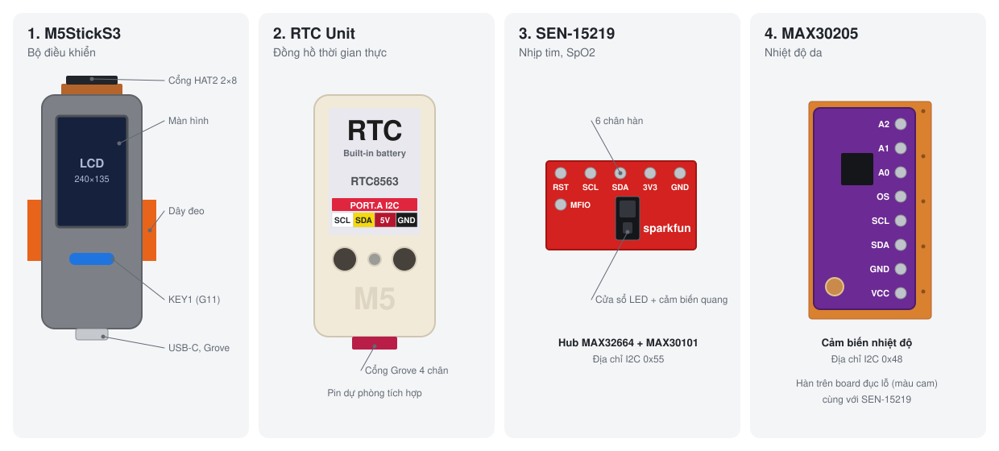
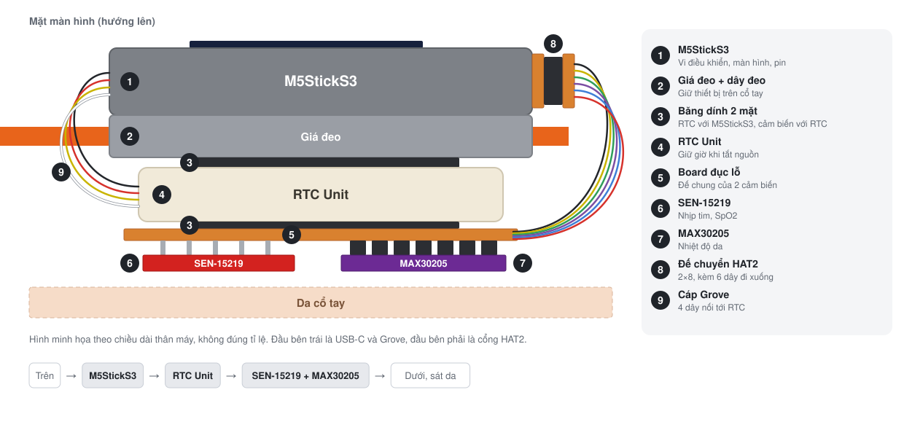
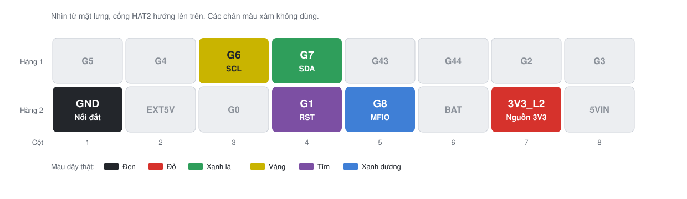
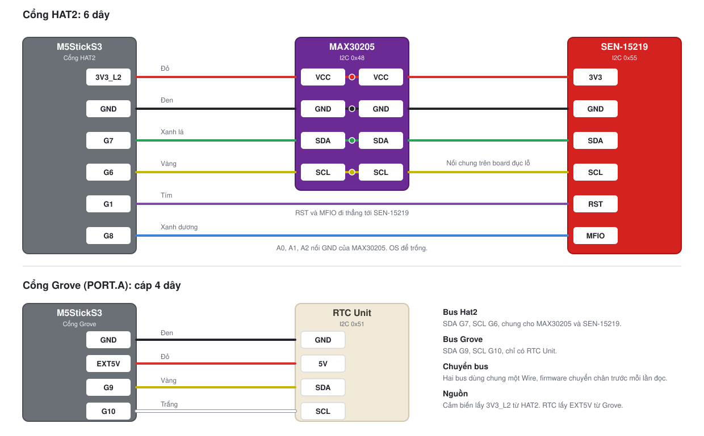

# Phần cứng và sơ đồ kết nối — VitalCare StickS3

Tài liệu mô tả thiết bị đeo tay đang dùng để phát triển firmware: gồm những linh kiện nào, xếp tầng ra sao và nối dây thế nào.

- Chân và địa chỉ I2C trong firmware: [`include/BoardPins.h`](../include/BoardPins.h)
- Các hình vẽ là minh họa theo ảnh chụp, **không đúng tỉ lệ**.

---

## 1. Danh sách thiết bị

| # | Thiết bị | Nhiệm vụ | Giao tiếp | Địa chỉ I2C |
|---|---|---|---|---|
| 1 | **M5StickS3** | Điều khiển, hiển thị, lưu dữ liệu, BLE | Cổng HAT2 2×8, Grove (PORT.A), USB-C | — |
| 2 | **RTC Unit** (module RTC8563, chip HYM8563, có pin dự phòng) | Giữ giờ khi thiết bị tắt | I2C qua cáp Grove | `0x51` |
| 3 | **SEN-15219** của SparkFun (MAX32664 + MAX30101) | Đo nhịp tim và SpO2 | I2C + 2 chân RST, MFIO | `0x55` |
| 4 | **MAX30205** (board tím) | Đo nhiệt độ da | I2C | `0x48` |

Vật liệu phụ: board đục lỗ màu cam, đế chuyển HAT2, giá đeo và dây đeo, cáp Grove, 6 dây điện nhỏ, băng dính 2 mặt.

**Thông số M5StickS3:**

| Mục | Giá trị |
|---|---|
| Vi điều khiển | ESP32-S3-PICO-1-N8R8 (8MB flash, 8MB PSRAM) |
| Màn hình | IPS 1.14 inch, 135×240, ST7789P3 |
| Pin | 3.7V, 250 mAh |
| Nút bấm | KEY1 G11 (nút xanh), KEY2 G12, nút nguồn |
| Thành phần khác | IMU BMI270, codec ES8311, loa AW8737, phát và thu hồng ngoại |
| Kích thước | 48 × 24 × 15 mm |

**Thông số RTC Unit:**

| Mục | Giá trị |
|---|---|
| Chip đồng hồ | HYM8563, thạch anh 32.768 kHz |
| Giao tiếp | I2C `0x51`, tối đa 400 Kbps |
| Nguồn | DC 5V |
| Kích thước, khối lượng | 48 × 24 × 8 mm, 7.4 g |

---

## 2. Cấu tạo theo tầng

Từ mặt màn hình xuống mặt tiếp xúc da:

| Tầng | Thành phần | Ghi chú |
|---|---|---|
| 1 | **M5StickS3** | Lắp trên giá đeo, cổng HAT2 ở một đầu, USB-C và Grove ở đầu còn lại |
| 2 | **RTC Unit** | Dán vào mặt lưng cụm M5StickS3 bằng băng dính 2 mặt, nối bằng cáp Grove |
| 3 | **SEN-15219 + MAX30205** | Hàn cạnh nhau trên board đục lỗ, dán vào RTC bằng băng dính 2 mặt, hướng về phía da |

Băng dính 2 mặt chỉ là cách cố định tạm thời, nằm ở 2 vị trí trên.

**Không bóc board cảm biến ra khỏi RTC:** các mối hàn dây nằm ở mặt sau board, đã bị dán kín, bóc ra có nguy cơ tuột dây.

---

## 3. Sơ đồ port và liên kết

### 3.1 Cổng HAT2 của M5StickS3

Hình được vẽ theo nhãn in ở mặt lưng M5StickS3. Khi nhìn đế chuyển từ trên xuống, hai hàng mối hàn giữ đúng thứ tự cột như nhãn.

### 3.2 Sơ đồ nối dây

**SDA, SCL, 3V3, GND của hai cảm biến nối chung tại MAX30205**, rồi từ MAX30205 đi thẳng tới cổng HAT2. RST và MFIO chỉ thuộc SEN-15219.

**Cổng HAT2 (6 dây):**

| Chân M5StickS3 | Vị trí (hàng, cột) | Màu dây | MAX30205 | SEN-15219 |
|---|---|---|---|---|
| `3V3_L2` | 2, 7 | Đỏ | `VCC` | `3V3` |
| `GND` | 2, 1 | Đen | `GND` | `GND` |
| `G7` | 1, 4 | Xanh lá | `SDA` | `SDA` |
| `G6` | 1, 3 | Vàng | `SCL` | `SCL` |
| `G1` | 2, 4 | Tím | — | `RST` |
| `G8` | 2, 5 | Xanh dương | — | `MFIO` |

**Cổng Grove PORT.A (cáp 4 dây):**

| Chân M5StickS3 | Màu dây | RTC Unit |
|---|---|---|
| `GND` | Đen | `GND` |
| `EXT5V` | Đỏ | `5V` |
| `G9` | Vàng | `SDA` |
| `G10` | Trắng | `SCL` |

### 3.3 Hai bus I2C

| Bus | SDA | SCL | Thiết bị |
|---|---|---|---|
| Hat2 | G7 | G6 | MAX30205 (`0x48`), SEN-15219 (`0x55`) |
| Grove | G9 | G10 | RTC Unit (`0x51`) |

Hai bus dùng chung một đối tượng `Wire`, nên firmware chuyển chân trước mỗi lần đọc (`I2cBusManager`).

**Các chân còn lại của MAX30205:**

| Chân | Trạng thái | Ý nghĩa |
|---|---|---|
| `A0`, `A1`, `A2` | Nối GND của MAX30205 | Tạo địa chỉ I2C `0x48` |
| `OS` | Để trống | Firmware không dùng |

### 3.4 Nguồn

| Đường nguồn | Cấp cho | Điều khiển |
|---|---|---|
| `3V3_L2` | MAX30205, SEN-15219 | Bộ quản lý nguồn, tín hiệu `PM_3V3_L2_EN` |
| `EXT5V` | RTC Unit | Bộ quản lý nguồn, tín hiệu `PM_EXT5V_EN`. Firmware bật bằng `M5.Power.setExtOutput(true)` |

Cả hai đường đều bật tắt được từ bộ quản lý nguồn theo sơ đồ in trên mặt lưng. Cần lưu ý điểm này khi làm ngủ sâu.

---

## 4. Nguồn thông tin

- **Chân và địa chỉ:** nhãn in trên M5StickS3 và RTC, `BoardPins.h`, thông số nhà sản xuất.
- **Nối dây:** ảnh chụp cho thấy đầu dây ở cổng HAT2. Đầu dây phía cảm biến nằm sau board đã dán kín, nên được xác định theo `BoardPins.h` và mô tả của người lắp.

Ảnh chụp thiết bị:

- [Mặt trước M5StickS3](anh_chup_mat_truoc_m5stick.jpg)
- [Mặt lưng M5StickS3 và mặt trước hai cảm biến](anh_chup_mat_lung_m5stick_va_mat_truc_dien_cam_bien.jpg)
- [Mặt lưng và nhãn chân HAT](anh_chup_truc_dien_lung_va_so_do_port.jpg)
- [Đế chuyển HAT nhìn từ trên xuống](anh_chup_port_m5_tren_xuong.jpg)
- [Mặt trước RTC và nhãn chân](anh_chup_mat_truoc_RTC_va_so_do_port_rtc.jpg)

Tài liệu nhà sản xuất:

- [Sơ đồ mặt lưng M5StickS3](anh_mat_lung_m5stack_co_so_do_port.webp)
- [Chi tiết hai mặt M5StickS3](anh_chi_tiet_thiet_bi_m5stick_o_ca_2_mat.webp)
- [Kích thước M5StickS3](anh_kich_thuoc_m5stick.webp)
- [Thông số RTC Unit](anh_spec_rtc.png)
